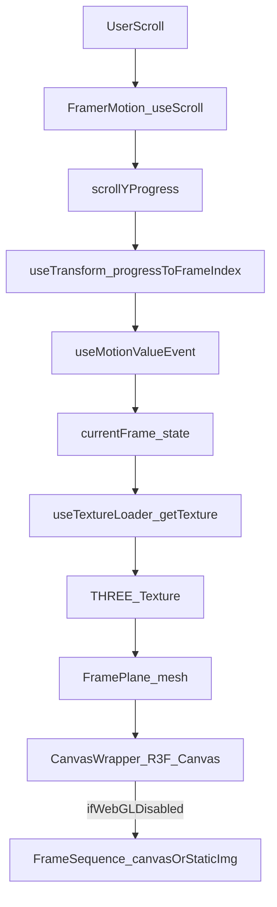

## Code Audit Report (Modern Resume Site)

- **Date**: 2025-12-24
- **Project version**: `0.1.17` (from `package.json`)
- **Stack (current)**: Next.js `16.1.0` (App Router), React `19.2.3`, TypeScript `^5`, Tailwind `^4`, Framer Motion `^12`, Three.js `^0.170`, Zustand `^5`

### Executive summary

This is a **high-quality front-end codebase** with strong guardrails (strict TS + ESLint core-web-vitals with `--max-warnings=0`) and unusually thorough test coverage for a portfolio site (unit + E2E). The architecture is centered around a **scroll-synchronized frame system** with a unified WebGL renderer and a canvas fallback.

The biggest gaps are **reliability and “single source of truth” issues** in the animation/loading pipeline:

- **P0**: `useFramePreload` can **never complete** if any frame fails to load (progress stalls; loaders depending on completion can get stuck).
- **P1**: `useTextureLoader` uses a polling `setInterval` path that can **run forever** for failed loads (leak).
- **P1**: Docs/config drift around **asset URL env vars** and **Next.js version** increases onboarding and deployment risk.

### Evidence & repo metrics (objective checks)

All checks below were executed in this repo and passed:

- **Lint**: `npm run lint` ✅ (ESLint `--max-warnings=0`)
- **Type-check**: `npm run type-check` ✅ (strict TS)
- **Unit tests**: `npm test` ✅
  - **42** test files, **590** tests passed
  - Notable **test noise** (but not failures):
    - JSDOM: “Not implemented: HTMLCanvasElement.getContext()”
    - React warnings for `<ambientLight>` in unit tests (JSDOM doesn’t understand R3F tags)
    - “Multiple instances of Three.js being imported.” (seen in some tests)
- **Coverage**: `npm run test:coverage` ✅
  - **Statements** 98.52%, **Branches** 92.5%, **Functions** 100%, **Lines** 98.5%
  - Note: coverage config is scoped (see `vitest.config.ts` include list), so this is **not** total-repo coverage.
- **Production build**: `npm run build` ✅
  - Routes are statically prerendered: `/`, `/_not-found`, `/demo/*`

Additional static “shape” metrics:

- **Client components**: 88 files contain `"use client";` (large client surface area is expected for this UX, but it’s a cost).
- **Inline lint suppressions**: 9 `eslint-disable` occurrences total (5 in source code, 4 in tests/e2e). Low overall.
- **TODO/FIXME**: none found.

## Architecture & dataflow

### High-level structure

- **Framework**: Next.js App Router
  - Root layout is a server component: `app/layout.tsx`
  - Main route is implemented as a client component: `app/page.tsx` (expected due to scroll + WebGL + window APIs)
- **Primary modules**
  - `components/sections/*`: “page sections” (Hero/Product/About/Skills/Projects/Contact)
  - `components/three/*`: R3F/Three rendering (unified canvas, particles, glow, fallbacks)
  - `components/animation/*`: canvas-based frame renderer fallback
  - `hooks/*`: scroll, frame mapping, preloading, texture management, parallax
  - `stores/*`: Zustand stores (loading + animation state)
  - `lib/*`: URL generation, a11y helpers, validation, small utils

### Frame animation pipeline (what happens at runtime)

The core runtime experience is a **sticky scroll runway**: sections are tall (`300vh` hero, `225vh` product), and the viewport stays sticky while scroll progress maps to a frame index.

Key path (happy case):

- `HeroSection` / `ProductSection` creates a section ref and renders `UnifiedHeroCanvas`.
- `UnifiedHeroCanvas` uses `useUnifiedFrameAnimation` to:
  - map scroll → `frameIndex` (`useFrameAnimation`)
  - preload frames into the browser cache (`useFramePreload`)
  - convert nearby frames to GPU textures with LRU eviction (`useTextureLoader`)
- `FramePlane` draws the current texture using a full-screen plane and adjusts UVs for “cover”.
- If WebGL can’t/shouldn’t render, `UnifiedHeroCanvas` falls back to `components/animation/FrameSequence`.

Mermaid overview:

### Asset delivery architecture (dev/prod)

The documented intent is:

- MinIO stores WebP frames in buckets (`frames-desktop/*`, `frames-mobile/*`).
- Nginx proxies and caches under `/assets/*` (7-day immutable caching), with dev CORS for `http://localhost:3017`.

Observed in code/docs:

- Nginx supports **both** `/assets/...` and direct bucket paths `/frames-desktop/...` (see `docker/nginx/conf.d/default.conf`).
- `lib/frame-utils.ts` uses `NEXT_PUBLIC_FRAME_BASE_URL` (default `http://localhost:8089`) and generates URLs **without** the `/assets` prefix.
- Docs (`docs/ASSET_URLS.md`) emphasize `NEXT_PUBLIC_ASSET_BASE_URL=http://localhost:8089/assets`.

This is workable but confusing—see “Docs & configuration drift”.

## Code quality & design review

### Strengths

- **Strong correctness guardrails**
  - TS strictness is high (`noUnusedLocals`, `noImplicitReturns`, etc.)
  - ESLint is strict and enforced (`--max-warnings=0`), including `no-explicit-any`
- **Good modular decomposition for the “hard parts”**
  - Scroll mapping, preloading, WebGL texture management, and fallbacks are split into focused hooks/components.
- **Accessibility is a first-class concern**
  - `SkipLink`, focus styles, form ARIA patterns, and reduced motion support are implemented and tested.
- **Testing depth**
  - 590 unit tests + Playwright suite (configured) is far beyond typical portfolio standards.

### Design/maintainability issues

- **Duplicated constants and configuration**
  - Frame counts exist in multiple places:
    - `types/animation.ts:412` exports `FRAME_COUNTS` (canonical source)
    - `hooks/useUnifiedFrameAnimation.ts:32` defines `SEQUENCE_FRAME_COUNTS`
    - `hooks/useFrameSequence.ts:30` also defines `SEQUENCE_FRAME_COUNTS`
  - Recommendation: designate a single source of truth (e.g., `FRAME_COUNTS` from `types/animation.ts`) and import everywhere.
- **Two loading state systems**
  - `app/page.tsx` uses local `useState` for loading/progress, while `stores/loading-store.ts` + `components/loading/LoadingProvider.tsx` implement a global orchestration pattern.
  - Recommendation: pick one approach (for a single-page app, a provider/store is usually cleaner).
- **Some “lint suppression as structure”**
  - Example: `components/parallax/ParallaxContainer.tsx` uses a `no-duplicate-imports` inline suppression for type/value imports.
  - Recommendation: resolve with combined import syntax (`import { X, type Y } ...`) to remove the suppression.
- **Barrel export drift**
  - `components/sections/index.ts` only exports `HeroSection`, but the app imports other sections directly.
  - Recommendation: either complete the barrel exports or remove it.

## Reliability & correctness risks

### P0: Preloading can stall forever on any frame error

In `hooks/useFramePreload.ts`, `img.onerror` resolves without incrementing `loadedCount`. Completion is triggered only when `loadedCount === totalCount`, so a single failing image can prevent `onComplete` and keep the app “loading” indefinitely.

Why it matters in this repo:

- The home route’s loading overlay is dismissed via callbacks wired through `HeroSection` → `UnifiedHeroCanvas` → `useUnifiedFrameAnimation` → `useFramePreload`.
- Any transient 404/CORS/network issue can leave users stuck behind the loading overlay.

Recommendation (high-level):

- Track **attempted** count separately from **success** count, or treat errors as “done” for progress/completion.
- Add cancellation/cleanup for in-flight loads (optional improvement).

### P1: Potential infinite polling interval in texture loader

In `hooks/useTextureLoader.ts` (lines 102-112), when a frame is "already loading", the code starts a `setInterval` polling loop waiting for `img.complete`. This interval can run indefinitely in two scenarios:

1. **Failed loads**: If the load fails (`onerror`), the image is never added to the cache and the interval never finds a complete image.
2. **Component unmount**: If the component unmounts while waiting for a concurrent load, the interval continues running because it's created inside the `loadImage` callback (not in a `useEffect` with cleanup).

Recommendation:

- Replace polling with a per-index promise registry (dedupe in-flight loads), or at minimum:
  - include a timeout to clear intervals
  - cache failures as terminal states
  - track intervals in a ref and clear on unmount

### P2: Test environment warning noise can mask real issues

Current unit tests pass, but warnings are noisy:

- JSDOM canvas limitations create repeated stderr output.
- R3F tags create “incorrect casing/unrecognized” warnings.
- “Multiple instances of Three.js” warning appears in tests.

Recommendation:

- Add a test-only canvas polyfill/mocking strategy (or the `canvas` npm package if acceptable).
- Mock R3F primitives in unit tests to reduce DOM warnings.
- Investigate the “multiple three imports” warning (dependency resolution and test mocks).

## Performance review (front-end)

### Strengths

- **Priority + idle-time preloading**: `useFramePreload` loads first N frames, then uses `requestIdleCallback` batching.
- **GPU memory control**: `useTextureLoader` keeps a bounded GPU texture pool (LRU eviction).
- **Degradation strategy**: mobile and reduced motion disable expensive rendering paths (static first frame).
- **Static prerender**: Next build outputs static pages for routes (fast TTFB).

### Risks / improvement opportunities

- **Concurrency spike on priority load**
  - Priority frames are loaded with `Promise.all`, which can open many parallel requests at once.
  - Consider a small concurrency limit (e.g., 4–8) for more stable network behavior.
- **Duplicate caching layers**
  - Some paths can lead to keeping both the browser cache + explicit `Image()` refs for many frames (memory pressure on weak devices).
  - Consider caching only a window (virtualization) for canvas fallback, or reusing the loader’s cache rather than creating all new `Image()` refs.

## Security review

### Current posture

- Next.js `poweredByHeader` is disabled (`next.config.ts`).
- Vercel headers (`vercel.json`) set basic security headers.
- Nginx config sets some headers (but differs from Vercel) and implements dev CORS.

### Gaps / recommendations

- **Header parity**: align security headers across Vercel vs Docker/Coolify paths (currently they differ: e.g., `X-Frame-Options` is `DENY` in Vercel but `SAMEORIGIN` in Nginx).
- **CSP**: consider a Content Security Policy (non-trivial with WebGL + Next, but valuable).
- **Pinned images**: `docker-compose.yml` uses `minio/minio:latest`; pin versions for reproducibility.
- **Default dev credentials**: docker-compose contains default MinIO/Postgres creds; ensure production deploys override via secrets.

## Testing & QA

### What’s strong

- Unit tests cover both logic and many UI components.
- E2E suite exists and includes accessibility checks (`@axe-core/playwright`), navigation, visual regression, and form behavior.

### Gaps / opportunities

- Coverage is currently scoped to a subset of files; consider expanding over time to cover:
  - frame preloading/texture loader error paths
  - “loading overlay dismissal” end-to-end behaviors (especially failure modes)

## Docs & configuration drift (DX)

Key inconsistencies to address:

- **Next.js version drift**: docs mention Next.js 15, repo uses Next.js 16 (`package.json`, build output).
- **Asset env var naming drift**:
  - docs emphasize `NEXT_PUBLIC_ASSET_BASE_URL` (with `/assets`)
  - runtime frame URLs use `NEXT_PUBLIC_FRAME_BASE_URL` (without `/assets`)
- **`.env` handling drift**:
  - docs describe `.env` as committed, but `.gitignore` ignores `.env` (safer default; docs should match reality).
- **Docker node version vs docs**:
  - docs require Node 20+, Docker uses Node 22. Either is fine, but be explicit.

Recommendation: make docs reflect actual runtime and adopt a “single canonical env var” story (or document both clearly).

## Prioritized findings (P0/P1/P2)

### P0 (must fix / high user impact)

- **`useFramePreload` completion logic breaks on any load error** → can strand loading overlays and prevent content reveal.

### P1 (should fix / medium risk)

- **`useTextureLoader` polling interval can leak on failed loads**.
- **Env var / asset URL drift** increases deployment/onboarding friction and misconfiguration risk.
- **Duplicated frame counts/config** increases maintenance cost and risk of silent divergence.

### P2 (nice-to-have / polish)

- Reduce unit test stderr noise (canvas + R3F warnings) to keep CI signal high.
- Remove lint suppressions by restructuring imports.
- Clean up incomplete barrel exports and legacy/unused paths.

## Recommended remediation backlog (actionable)

- **P0**: Fix `useFramePreload` so completion progresses even with per-frame failures (count attempts; surface error rate; add overall timeout).
- **P1**: Refactor `useTextureLoader` to dedupe in-flight loads without polling; add failure terminal states.
- **P1**: Consolidate frame sequence config:
  - one source of truth for frame counts and IDs (`types/animation.ts` is a good home)
  - remove duplicated `SEQUENCE_FRAME_COUNTS` in hooks
- **P1**: Standardize asset env vars and URL shapes; update docs (`docs/ASSET_URLS.md`, `docs/environments.md`, `docs/ARCHITECTURE.md`) to match code.
- **P2**: Improve test environment:
  - canvas mocking/polyfill
  - reduce R3F DOM warnings
  - investigate “multiple three imports” warning

## Optional follow-ups (if you want deeper coverage)

- Run Playwright E2E (`npm run test:e2e`) to validate runtime flows (not run in this audit by default since it starts a dev server).
- Run dependency vulnerability scan (`npm audit`) and/or add Dependabot.
- Add bundle analysis report (`npm run analyze`) and capture “top 10” bundle contributors.
